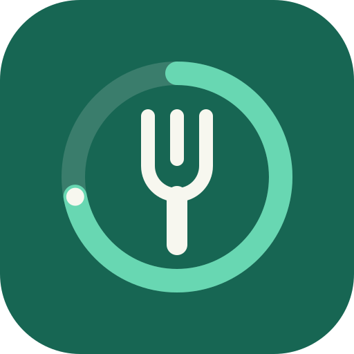

# CalorieCopilot

A calorie-tracking web app built with **Next.js 16 (App Router) and TypeScript**, **Turso** (libSQL), **Bootstrap 5** and
**Bootstrap Icons**. It's designed to deploy to **Vercel**.

## Features

| | |
|---|---|
| **Daily diary** | Log breakfast, lunch, dinner and snacks. Shows a calorie ring against your goal, macro progress bars, edit/delete, quick-add from recent foods, "copy from yesterday" and day-by-day navigation. |
| **Barcode scanning** | Scan packaged food with your phone or laptop camera. Decoding uses the browser's built-in `BarcodeDetector` where there is one (Chrome on Android) and otherwise [zxing-cpp](https://github.com/zxing-cpp/zxing-cpp) compiled to WebAssembly, served from the app itself. The camera runs at up to 1080p with 2× zoom where supported, so you can hold the phone far enough away to focus. You can also scan from a photo or type the number; if you leave off the small digits printed beside the bars, the app works them out. Products are looked up in [Open Food Facts](https://world.openfoodfacts.org) and cached. Unknown products can be entered once and are remembered for your next scan. Supports EAN-13/8, UPC-A/E, Code 128 and ITF. |
| **Analytics** | 7/30/90-day views: daily calories vs. goal, average macro split, calories by meal, weight trend, logging streak, days on target and most-logged foods (with a table view of the raw data). Charts by Chart.js, with light and dark themes. |
| **Profile settings** | Display name, email, time zone (decides when your "today" starts), metric/imperial units, body stats and activity level, Mifflin-St Jeor target suggestions you can apply in one click, manual calorie/macro targets, password change and account deletion. |

It also has a mobile bottom tab bar, a dark mode toggle, can be installed to a phone's home screen, locks an account after
repeated failed sign-ins, and sends security headers.

## Deploying to Vercel

1. Create a Turso database and token with the [Turso CLI](https://docs.turso.tech/cli/introduction):

   ```bash
   turso db create caloriecopilot
   turso db show caloriecopilot --url        # libsql://caloriecopilot-<org>.turso.io
   turso db tokens create caloriecopilot
   ```

   (Or add the Turso integration from the Vercel Marketplace, which creates
   the database and sets the variables for you.)

2. Import this repository in Vercel. It's detected as a Next.js project automatically; no build settings are needed.

3. Add these environment variables to the Vercel project (Production, Preview and Development):

   | Variable | Value |
   |---|---|
   | `TURSO_DATABASE_URL` | `libsql://caloriecopilot-<org>.turso.io` |
   | `TURSO_AUTH_TOKEN` | the token from step 1 |

4. Deploy. The schema is created automatically on first request with idempotent `CREATE TABLE IF NOT EXISTS`
   statements. You can also apply it ahead of time with `npm run db:migrate`.

Use a fresh database. The schema differs from the earlier .NET version of this app.

## Running locally

Requires Node.js 20.9 or later.

```bash
npm install
npm run dev
```

Open http://localhost:3000. Without `TURSO_DATABASE_URL`, development uses a local SQLite file (`local.db`), so it runs
with zero setup. To use Turso locally, copy `.env.example` to `.env.local` and fill it in, or run `turso dev` and set
`TURSO_DATABASE_URL=http://127.0.0.1:8080`.

A production build (`npm run build && npm start`) requires `TURSO_DATABASE_URL`. For a local test, set it to
`file:local.db`.

> **Camera access needs a secure context.** Browsers only allow the camera on `https://` or `http://localhost`.
> To test scanning on a phone, use a Vercel preview deployment or a tunnel such as `ngrok` / `cloudflared`.
> "Scan from photo" and manual entry work anywhere.

| Script | |
|---|---|
| `npm run dev` | Development server |
| `npm run build` / `npm start` | Production build and server |
| `npm run typecheck` | TypeScript check |
| `npm run db:migrate` | Apply the schema to `TURSO_DATABASE_URL` (or `local.db`) |

## How it fits together

```
app/
├── page.tsx, login/, register/       # landing and sign-in pages
├── diary/  scan/  analytics/  profile/  # the four main pages (server components + client islands)
├── actions/                          # server actions: auth, diary, profile, analytics
└── api/products/[barcode]/route.ts   # barcode lookup used by the scanner
components/                           # navbar, tab bar, flash messages, calorie ring, form helpers
lib/
├── db.ts, schema.ts                  # Turso client (@libsql/client) and schema
├── auth.ts, password.ts, users.ts    # sessions, scrypt password hashing, user records
├── food.ts, products.ts, weights.ts  # data access
├── barcode.ts, camera-scanner.ts     # check digits / typed-code handling; camera + decoder
├── openfoodfacts.ts                  # barcode -> nutrition lookup
├── goals.ts                          # Mifflin-St Jeor BMR/TDEE -> calorie & macro targets
└── validation.ts                     # zod schemas for every form
proxy.ts                              # redirects signed-out visitors away from protected pages
public/                               # logo, app icons, web app manifest
```

**Authentication** is built in, with no third-party auth service:
- Passwords are hashed with scrypt from Node's built-in `crypto`.
- Sessions are random tokens in an `HttpOnly`, `SameSite=Lax` cookie. Only a SHA-256 of each token is stored in Turso,
  so a database leak can't be replayed as cookies.
- Five failed sign-ins lock the account for 10 minutes.
- Changing your password signs out every other device.
- Server actions get Next.js's built-in origin checks against cross-site request forgery.

**Forms** use React server actions with zod validation. Errors are shown next to each field, and your input is kept when
something needs fixing.

**Product data** comes from Open Food Facts, licensed under the [ODbL](https://opendatacommons.org/licenses/odbl/1-0/).
Lookups go through the server, which caches them for 30 days, so the browser never calls third-party APIs directly.

## Brand



The mark is a fork inside a calorie progress ring, the same ring the diary uses to show what's left for the day.

| Colour | Hex | Used for |
|---|---|---|
| Forest green | `#176653` | Brand, primary actions, progress (light mode) |
| Mint | `#68D7B2` | Accent, focus rings; primary in dark mode |
| Near-black | `#17211F` | Text; dark-mode background |
| Warm off-white | `#F7F7EF` | Page background; dark-mode text |

The palette is applied by overriding Bootstrap's CSS variables in `app/globals.css`, so every component follows it in both
light and dark mode. All text pairs meet WCAG AA contrast. Macro and meal charts keep a separate colourblind-safe
categorical palette so protein, carbs and fat stay distinguishable.
